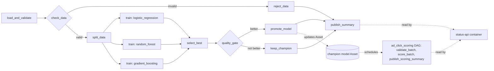
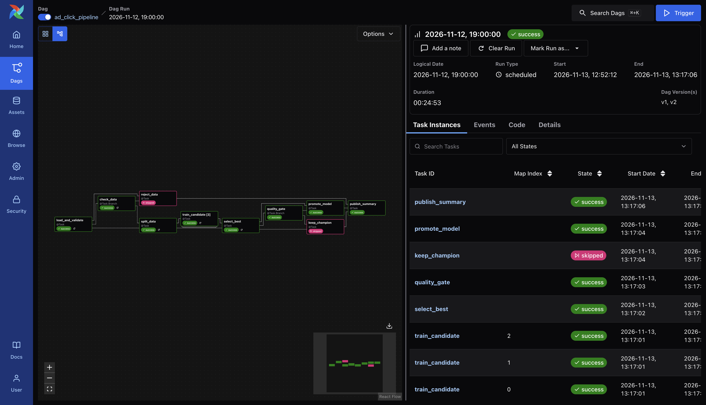
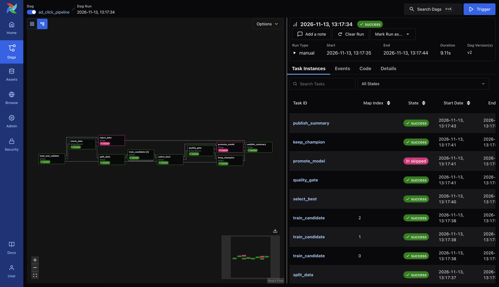
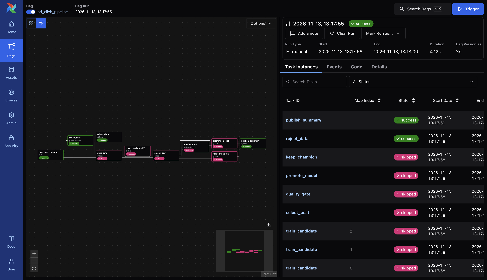
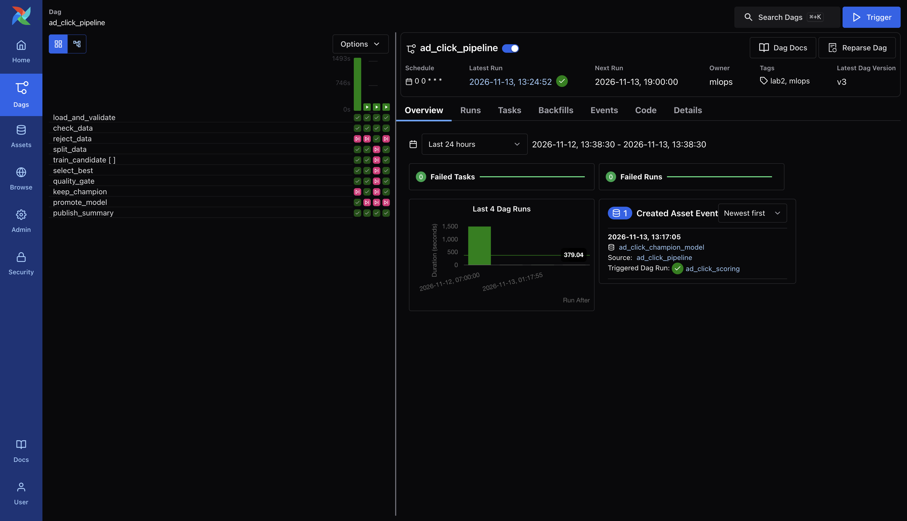
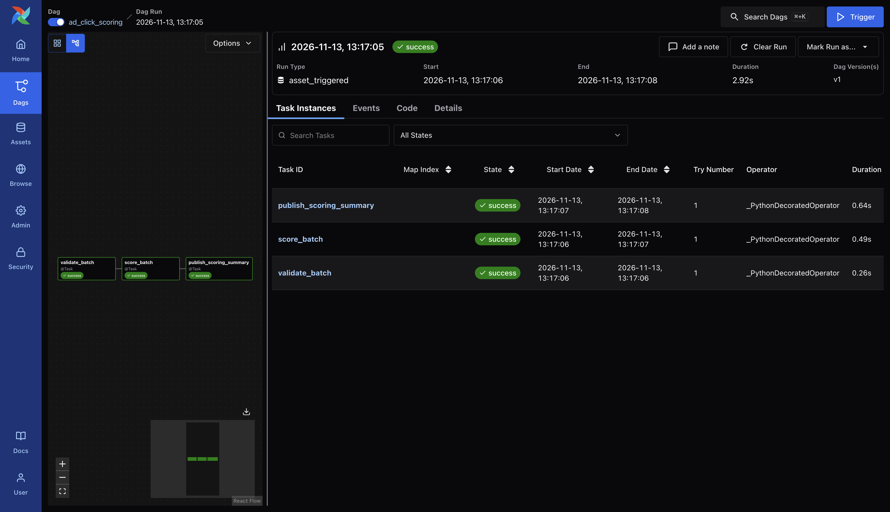
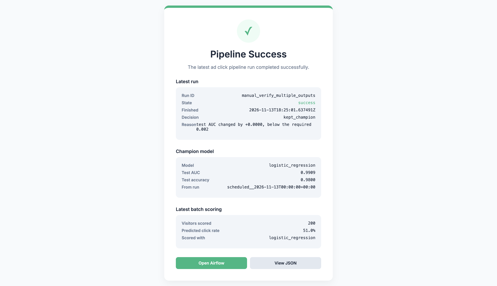

# Airflow Lab: Orchestrating an Ad Click Model Pipeline

Author: Tirth Borasaniya, IE-7374 MLOps

Based on `Labs/Airflow_Labs/Lab_2` from the IE-7374 MLOps course repository. The original lab has two DAGs: one trains a logistic regression on an advertising dataset, the other starts a Flask page that reports whether the last training run succeeded. This version keeps that idea and rebuilds the orchestration: data validation with branching, parallel training with dynamic task mapping, a quality gate before promotion, a scoring DAG triggered by Airflow Assets when a new model is promoted, retries and notifications, and a status service that runs beside Airflow instead of inside it.

Original lab: https://github.com/raminmohammadi/MLOps/tree/main/Labs/Airflow_Labs/Lab_2

**Contents:** [Summary](#summary-original-vs-this-version) · [Changes to the core concept](#changes-to-the-core-concept) · [Bugs fixed](#bugs-fixed-from-the-original-lab) · [Prerequisites](#prerequisites) · [Setup](#setup) · [Running the lab](#running-the-lab) · [What a successful run looks like](#what-a-successful-run-looks-like) · [Troubleshooting](#troubleshooting) · [Results](#results) · [Project structure](#project-structure)

## Summary: original vs this version

| Area | Original lab | This version |
| --- | --- | --- |
| Pipeline shape | A straight line of tasks, including an `echo 1` task and a task that does nothing | Branches on data quality and on model quality |
| Data checks | None | Validation task; bad data stops the run with a recorded reason |
| Training | One logistic regression | Three candidates trained in parallel with dynamic task mapping, best one selected |
| Promotion | Every run overwrites `model.sav` | Quality gate: promoted only if it beats the current champion on the same test set |
| Reliability | No retries, no timeouts, email task commented out | Retries with exponential backoff, timeouts, failure and success callbacks, optional email |
| Artifacts | Fixed file names shared by every run | One folder per run, plus a registry with a champion and a decision history |
| Linking DAGs | `TriggerDagRunOperator` fires the Flask DAG after every run, success or failure | A scoring DAG scheduled on an Asset, which runs only when a new model is promoted |
| Inference | None; the model is never used | Batch scoring of new visitors with the champion, predictions saved per run |
| Status page | Flask started inside an Airflow task that never finishes | Separate container that reads the Airflow REST API and the registry |
| Deployment | No compose file; config file with committed secrets and example DAGs | Laptop-sized compose file (LocalExecutor, PostgreSQL), settings in environment variables |
| Automation | None | CI runs unit tests, DAG integrity tests, the training DAG twice, and the scoring DAG |

## How it works



Two DAGs run here. `ad_click_pipeline` trains and decides on promotion, daily or on demand. `ad_click_scoring` has no clock schedule: it runs whenever `promote_model` updates the champion model Asset.

## Changes to the core concept

The lab's core concept is workflow orchestration with Airflow. Every change below is in how the workflow is defined, scheduled, and run.

### 1. Data validation with branching (`dags/ad_click_pipeline.py`, `dags/src/data.py`)
- `load_and_validate` checks required columns, row count (at least 500), missing values, that the target is 0 or 1, class balance (minority class at least 20 percent), and value ranges.
- `check_data` is a `@task.branch`: valid data continues to `split_data`; invalid data goes to `reject_data`, which records the reason and sends a notification. Everything downstream of training is skipped, not failed.
- The validation report is saved with the run (`validation.json`).

### 2. Parallel training with dynamic task mapping (`dags/ad_click_pipeline.py`, `dags/src/training.py`)
- `train_candidate.partial(...).expand(candidate=[...])` creates one task instance per model at run time: logistic regression, random forest, and gradient boosting train in parallel.
- `select_best` collects all mapped results, picks the highest validation AUC, scores that model once on the held-out test set, and saves a leaderboard.
- Each model is saved as a full pipeline, scaler included, so it can score raw rows.

### 3. Quality gate with branching and run parameters (`dags/ad_click_pipeline.py`, `dags/src/registry.py`)
- The current champion is re-scored on this run's test set, so both models face the same data.
- `quality_gate` is a `@task.branch`: the candidate is promoted only if its test AUC clears a floor (default 0.9) and beats the champion by a margin (default 0.002). Otherwise `keep_champion` runs.
- The floor and margin are **DAG params**, editable when triggering a run from the UI. A third param, `simulate_bad_data`, demonstrates the rejection branch.
- Every decision is appended to `registry/history.jsonl` with its reason.

### 4. Reliability and notifications (`dags/ad_click_pipeline.py`, `dags/src/notifications.py`)
- Every task retries twice with exponential backoff (20 seconds, capped at 5 minutes) and has a 10-minute timeout.
- Task failure, run success, and run failure callbacks send a notification. With SMTP settings in `.env` it is emailed; without them it is written to `artifacts/notifications.log`, so the lab works without an email account. A mail error never fails the pipeline.
- `publish_summary` uses the `none_failed_min_one_success` trigger rule, so it runs after whichever branch was taken.

### 5. Idempotent, traceable runs (`dags/src/config.py`, `dags/src/registry.py`)
- Each run writes to `artifacts/runs/<run_id>/`: validation report, splits, candidate models, leaderboard, gate decision.
- The registry keeps the champion model and its metrics (`registry/champion.json`), so a rerun never overwrites a better model.
- Only small values (paths and metrics) pass between tasks through XCom; data and models stay on disk.

### 6. Asset-driven scoring DAG (`dags/ad_click_scoring.py`, `dags/src/assets.py`, `dags/src/scoring.py`)
- `promote_model` declares the champion model **Asset** as an outlet. Airflow records an Asset event only when that task succeeds, so a skipped promotion triggers nothing.
- `ad_click_scoring` is scheduled on that Asset (`schedule=[CHAMPION_MODEL_ASSET]`), Airflow 3's data-aware scheduling. It replaces the original's `TriggerDagRunOperator`, which fired after every run regardless of outcome.
- It validates a batch of new visitors (`dags/data/new_visitors.csv`, 200 rows without labels), scores them with the champion, and saves `artifacts/predictions/<run_id>.csv` with a click probability and a predicted click for each visitor. An invalid batch fails the run with the reasons, which triggers the failure notification.

### 7. Status service outside Airflow (`status_api/`)
- The Flask app runs in its own container with gunicorn, instead of an Airflow task that blocks a worker forever.
- It reads the latest run through the Airflow REST API (with a cached token), and the champion, decision, and latest batch scoring from the shared artifacts folder.
- Pages: `/` redirects to `/success` or `/failure`; `/api/status` returns JSON; `/health` is used by Docker.

### Also changed
- **Deployment:** a compose file sized for a laptop (LocalExecutor with PostgreSQL instead of Celery and Redis), a custom image with the pipeline's dependencies, health checks, and settings passed as environment variables.
- **Tests and CI:** 51 unit and service tests, DAG integrity tests, and a GitHub Actions job that installs Airflow, runs the training DAG twice with `airflow dags test` (checking that the first run promotes and the second keeps the champion), then runs the scoring DAG and checks its predictions.

## Bugs fixed from the original lab

| Problem in the original | Fix |
| --- | --- |
| `start_flask_app` never returns, so the Flask task runs forever and holds a worker slot | Status service runs as its own container |
| Every pipeline run triggers another Flask DAG run, which fails because port 5555 is already in use | No Flask DAG; the only DAG-to-DAG link is the Asset, which fires only on promotion |
| The trained model is never used for predictions | The scoring DAG scores new visitors with the champion |
| The fitted scalers are discarded and only the classifier is saved, so the saved model cannot score new raw data | The saved artifact is a full scikit-learn pipeline including the scaler |
| The same columns are scaled twice (`MinMaxScaler` and `StandardScaler`), duplicating every feature | Continuous columns are standardized once; the binary column passes through |
| All runs write `raw.pkl`, `preprocessed.pkl`, and `model.sav`, overwriting each other | One folder per run and a registry for the champion |
| A new model always replaces the old one, even if it is worse | Quality gate compares against the champion on the same test set |
| The score is only printed; `load_model` returns the first prediction, which means nothing | Metrics are saved, compared, and shown on the status page |
| Retries are 0 and the email task is commented out, so failures go unnoticed | Retries with backoff, timeouts, and failure callbacks with notifications |
| Folders are created when the DAG file is parsed, not when it runs | No side effects at import; folders are created by the tasks |
| `config/airflow.cfg` commits `fernet_key`, `jwt_secret`, and `secret_key`, uses SQLite, and loads example DAGs | No committed config; settings in the compose file and `.env`; examples disabled |
| No `docker-compose.yaml`, though `setup.sh` calls `docker compose` | Compose file included |
| `requirements.txt` is unpinned and includes unused `dvc[gs]` | Pinned versions; only what is used |
| The README describes email callbacks and a recipient that are not in the code | README matches the code |

## Prerequisites

Everything runs on your own computer; no cloud account is needed.

| Software | Version | How to get it |
| --- | --- | --- |
| Docker Desktop | 4.x or newer (includes Docker Compose v2) | https://www.docker.com/products/docker-desktop/ |
| Memory for Docker | **At least 4 GB** (Docker Desktop, Settings, Resources) | Airflow, PostgreSQL, and the status service together need about 3 GB |
| Git | Any recent version | https://git-scm.com/downloads |
| Python | 3.11, **only to run the tests locally** (optional) | https://www.python.org/downloads/ or conda |

Images used: `apache/airflow:3.0.2` (extended with scikit-learn 1.5.2), `postgres:16`, `python:3.11-slim`. They download on the first run, about 2 GB in total.

Check the installs:

```bash
docker --version
docker compose version
git --version
```

On Windows, run the commands below in WSL 2 (Docker Desktop's recommended setup) or Git Bash, since `setup.sh` is a Bash script.

## Setup

```bash
git clone https://github.com/TirthBorasaniya/airflow_ad_click_lab.git
cd airflow_ad_click_lab
./setup.sh
```

`setup.sh` creates the `logs/` and `artifacts/` folders and a `.env` file with your user ID, so files the containers write stay editable, and two random secrets that all Airflow containers share. Without a shared secret, the API server rejects the tokens tasks use and every task stays queued.

**Optional email:** to receive notifications by email, fill in the `SMTP_*` and `NOTIFY_EMAIL_TO` lines in `.env`. For Gmail, `SMTP_HOST=smtp.gmail.com` and `SMTP_PASSWORD` must be an [app password](https://support.google.com/accounts/answer/185833). Without these, notifications go to `artifacts/notifications.log`.

## Running the lab

**1. Start everything** (the first build takes about 5 minutes):

```bash
docker compose up -d --build
docker compose ps
```

Wait until `airflow-apiserver`, `airflow-scheduler`, `airflow-dag-processor`, and `status-api` show `(healthy)`, usually 1 to 2 minutes after the build. `airflow-init` shows `Exited (0)`, which is expected.

**2. Open Airflow** at http://localhost:8080 and log in with user `airflow`, password `airflow`.

**3. Switch both DAGs on:** in the DAG list, turn on the toggle next to `ad_click_pipeline` and next to `ad_click_scoring`. New DAGs start paused, and a paused scoring DAG would not react to a promotion.

**4. Run the pipeline:** click the play button (**Trigger**) on `ad_click_pipeline` and confirm. Open the DAG and select **Graph** to watch the tasks; the run takes about 30 seconds. When `promote_model` finishes, `ad_click_scoring` starts by itself; its run appears under that DAG, triggered by the Asset.

**5. Check the status service** at http://localhost:5555. It redirects to the success page with the run, the decision, the champion model, and the latest batch scoring. http://localhost:5555/api/status shows the same as JSON.

**6. See the quality gate:** trigger `ad_click_pipeline` again. This time `keep_champion` runs and `promote_model` is skipped, because the new model is not better than the champion. No new scoring run starts, since the champion did not change.

**7. See data rejection:** click **Trigger**, tick **simulate_bad_data** in the parameters form, and trigger. `reject_data` runs, training is skipped, and the reason appears in `artifacts/notifications.log`.

**8. Look at the artifacts** on your computer:

```bash
cat artifacts/registry/champion.json
cat artifacts/registry/history.jsonl
cat artifacts/notifications.log
ls artifacts/runs/
head -5 artifacts/predictions/*.csv
```

**Stop or reset:**

```bash
docker compose down              # stop, keep the database and artifacts
./setup.sh --reset               # remove containers, database, logs, and artifacts
```

### Running the tests locally (optional)

```bash
python3.11 -m venv airflow_lab_env
source airflow_lab_env/bin/activate      # Windows: airflow_lab_env\Scripts\activate
pip install -r requirements-dev.txt
pytest -v
flake8 dags status_api tests --max-line-length 100
```

The DAG integrity tests are skipped without Airflow installed; CI runs them.

## What a successful run looks like

**First run, Graph view:** all tasks green except `reject_data` and `keep_champion`, which are pink (skipped). `train_candidate` shows `[3]`, one mapped instance per model.

**Second run:** `promote_model` is skipped and `keep_champion` is green.

**Bad data run:** `reject_data` and `publish_summary` are green; `split_data` and everything after it are skipped.

**Scoring DAG:** exactly one run, created right after the first training run's promotion, with all three tasks green. Its predictions file starts like:

```
visitor_id,click_probability,predicted_click
V0001,0.9999,1
V0002,0.0216,0
```

About half of the 200 visitors are predicted to click.

**`artifacts/registry/history.jsonl`** after the three runs:

```
{"decision": "promoted", "reason": "no current champion", "candidate": "logistic_regression", "test_auc": 0.99..., ...}
{"decision": "kept_champion", "reason": "test AUC changed by +0.0000, below the required 0.002", ...}
```

The data-rejection run does not add a line here; its reason is in `artifacts/runs/<run_id>/decision.json` and `artifacts/notifications.log`.

All three candidates score a validation AUC around 0.98 to 0.99 on this dataset; logistic regression usually wins. Exact values can differ slightly between library versions.

**Status page:** "Pipeline Success" with the run ID, the decision and its reason, the champion's test AUC and accuracy, and the number of visitors scored with the predicted click rate.

**Tests:** `51 passed, 1 skipped` locally; the skipped file is the DAG integrity tests, which need Airflow.

## Troubleshooting

| Problem | Cause and fix |
| --- | --- |
| `docker: command not found` | Docker Desktop is not installed or not running. Start Docker Desktop and wait until it says it is running. |
| Containers restart repeatedly or are killed | Not enough memory. Give Docker at least 4 GB in Docker Desktop, Settings, Resources, then `docker compose up -d`. |
| `Bind for 0.0.0.0:8080 failed: port is already allocated` | Another program uses the port. Stop it, or change `"8080:8080"` to `"8081:8080"` in `docker-compose.yaml` and open http://localhost:8081. Same for 5555. |
| The DAG does not appear in the UI | The DAG processor scans every 30 seconds or so; wait a minute and refresh. Check for errors with `docker compose logs airflow-dag-processor`. |
| `Permission denied` writing to `logs/` or `artifacts/` | Run `./setup.sh` so `.env` has your user ID, then `docker compose up -d`. |
| Tasks stay `queued`; scheduler log shows `Invalid auth token: Signature verification failed` | The containers do not share a JWT secret. Run `./setup.sh` (it adds the secrets to `.env`), then `docker compose up -d`. |
| `required variable AIRFLOW_JWT_SECRET is missing` | Run `./setup.sh` before `docker compose up`. |
| Login fails | User and password are both `airflow` unless you changed them in `.env` before the first start. To apply new ones, run `./setup.sh --reset` and start again. |
| Status page says "could not authenticate with Airflow" | The API server is still starting; wait until `docker compose ps` shows it healthy. |
| Status page says "no runs yet" | Trigger `ad_click_pipeline` in the Airflow UI first. |
| `ad_click_scoring` never runs | It must be switched on, and it runs only after a promotion. Switch it on, then trigger it manually once or reset with `./setup.sh --reset` and run the pipeline again. |
| No email arrives | Check the `SMTP_*` values in `.env`, then `docker compose up -d` to apply them. Errors are logged in the task logs, and the notification is still written to `artifacts/notifications.log`. |

## Results

Screenshots from a local run:

1. DAG graph of the first run, with the parallel training tasks and the promotion branch: `docs/screenshots/01_graph_promoted.png`
2. DAG graph of the second run, with the champion kept: `docs/screenshots/02_graph_kept.png`
3. DAG graph of the bad data run, with training skipped: `docs/screenshots/03_graph_rejected.png`
4. Grid view with all three runs: `docs/screenshots/04_grid.png`
5. Scoring DAG run triggered by the champion model Asset: `docs/screenshots/05_scoring_run.png`
6. Status service page: `docs/screenshots/06_status_page.png`








## Project structure

```
.
├── .github/workflows/ci.yml       # unit tests, DAG integrity tests, DAG runs, compose check
├── dags/
│   ├── ad_click_pipeline.py       # training DAG
│   ├── ad_click_scoring.py        # scoring DAG, scheduled on the champion Asset
│   ├── data/
│   │   ├── advertising.csv        # dataset from the original lab
│   │   └── new_visitors.csv       # batch of 200 unlabeled visitors to score
│   └── src/
│       ├── assets.py              # the champion model Asset shared by both DAGs
│       ├── config.py              # paths, columns, thresholds, candidates
│       ├── data.py                # loading, dataset validation, batch validation
│       ├── scoring.py             # batch scoring with the champion
│       ├── training.py            # splitting, candidate pipelines, evaluation
│       ├── registry.py            # champion, promotion rule, history
│       └── notifications.py       # email or log notifications, Airflow callbacks
├── status_api/
│   ├── app.py                     # Flask status service
│   ├── templates/                 # success and failure pages
│   ├── Dockerfile
│   └── requirements.txt
├── tests/                         # unit, service, and DAG integrity tests
├── docs/screenshots/
├── docker-compose.yaml
├── Dockerfile                     # Airflow image with scikit-learn
├── requirements-airflow.txt       # extra packages for the Airflow image
├── requirements-dev.txt           # packages for running the tests locally
├── setup.sh
└── .env.example
```

## Dataset

`advertising.csv` from the original lab: 1,000 site visitors with daily time on site, age, area income, daily internet usage, and sex, and whether they clicked an ad (500 clicked, 500 did not). Text columns (ad topic line, city, country, timestamp) are not used as features.

`new_visitors.csv` simulates incoming traffic: 200 rows sampled from the same dataset with the label removed and a `visitor_id` added. Because they come from the same source, the predictions demonstrate the scoring flow rather than performance on unseen data.
